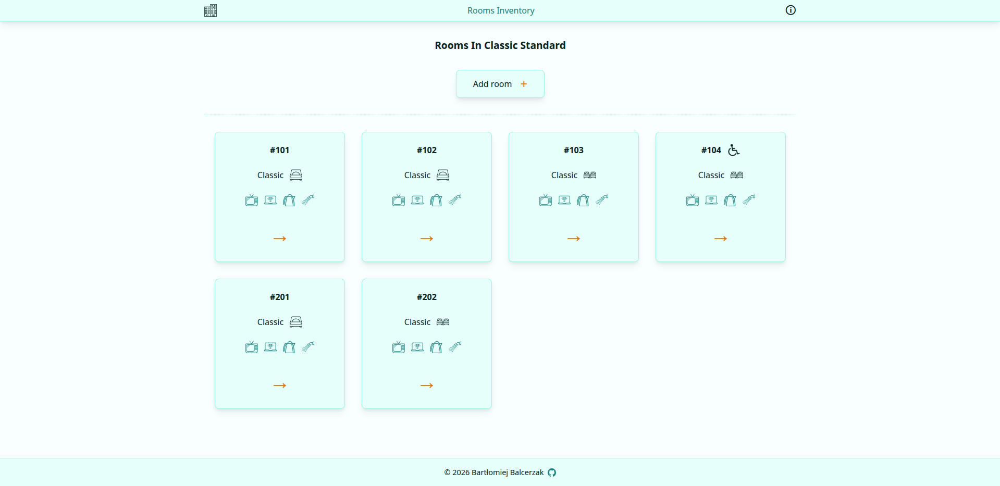
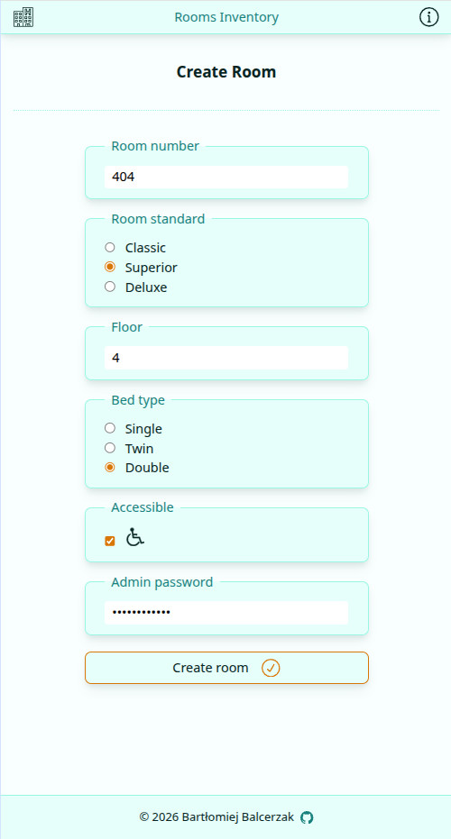
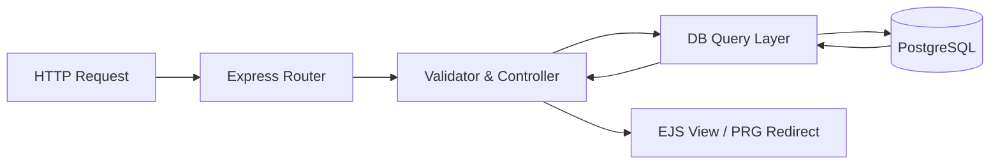
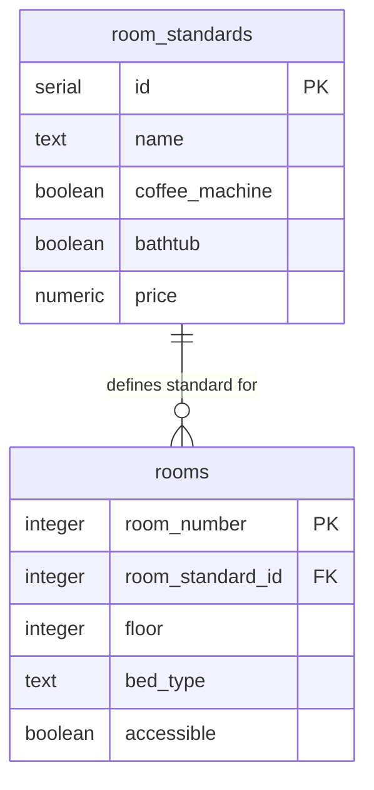

# Inventory Application (Hotel Rooms)

## Introduction

Inventory management web application for hotel rooms.

The project is part of the Node.js course of Full Stack JavaScript path of [The Odin Project](https://www.theodinproject.com/) curriculum.

## Live Preview

**[Click!](https://top-inventory-application-r69t.onrender.com/dashboard)**

## Table Of Contents

- [Introduction](#introduction)
- [Sample Screenshots](#sample-screenshots)
- [Tech Stack](#tech-stack)
- [Deployment](#deployment)
- [Project Structure](#project-structure)
- [Getting Started](#getting-started)
  - [Prerequisites](#prerequisites)
  - [Local Installation](#local-installation)
- [Data Flow Overview](#data-flow-overview)
- [Data Structure (Tables)](#data-structure-tables)
- [Areas To Improve](#areas-to-improve)

## Sample Screenshots

The frontend layer automatically detects user browser's color scheme and adopts respectively.





## Tech Stack

**Technologies:**


**Additional tools (dependencies):**

node-postgres (pg), express-validator, prettier-plugin-ejs, dotenv

## Deployment

**Web Service:**


**Database Hosting:**


## Project Structure

Each folder among `controllers/`, `routes/`, and `views/` contains subfolders `dashboard/`, `rooms/`, and `roomStandards/` to ensure project's clean structure, consistency and optimal DX.

```text
TOP-Inventory_Application/
├── controllers/
├── db/
|   ├── populate/
│   ├── bedTypes.js
│   ├── pool.js
│   ├── queriesRooms.js
│   └── queriesRoomStandards.js
├── public/
│   ├── screenshots/
│   ├── styles/
│   └── favicon.svg
├── routes/
├── views/
├── .gitignore
├── .prettierrc
├── app.js
├── package-lock.json
├── package.json
└── README.md
```

## Getting Started

### Prerequisites

- Node.js (v18+ recommended)
- PostgreSQL instance (local or cloud-hosted, e.g., Neon)

### Local Installation

**1. Clone the repository:**

```bash
git clone https://github.com/bartolinidev/TOP-Inventory_Application.git
cd TOP-Inventory_Application
```

**2. Install dependencies:**

```bash
npm install
```

**3. Configure environment variables:**

Create a `.env` file in the root directory and set the following variables:

```env
DATABASE_URL="your_database_url"
ADMIN_PASSWORD="your_secret_password"
```

**4. Seed the database:**

```bash
node db/populate/populatedb.js
```

**5. Start dev server:**

```bash
node app.js
```

## Data Flow Overview



## Data Structure (Tables)



## Areas To Improve

- Add advanced authentication (covered in the later part of the curriculum)
- Add API to serve raw data in JSON files
- Add search engine to look find rooms by id/number
- Extract partials like `room.ejs`, and `roomStandard.ejs`
